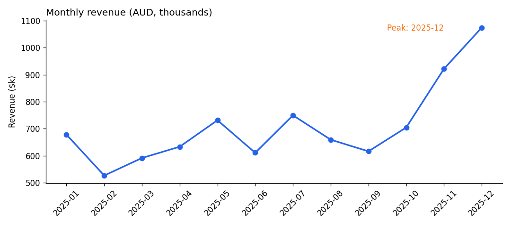
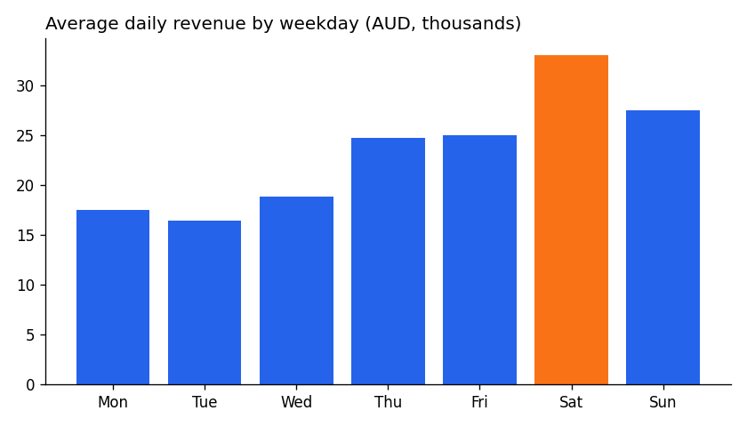
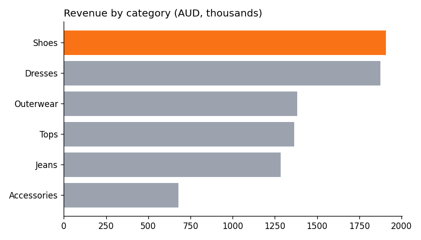
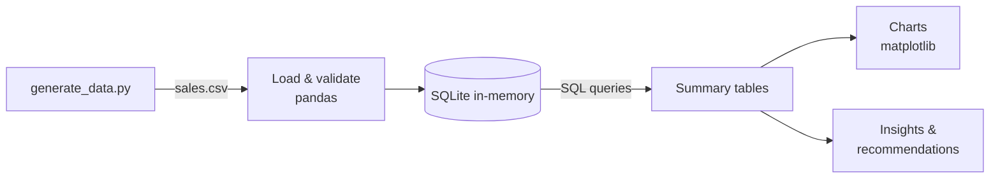

# 📊 Retail Sales Analysis — Python, SQL & Data Visualisation

> An end-to-end analysis of a year of fashion-retail sales across three Sydney stores, turning 75,000+ transactions into staffing, stock and pricing recommendations.




## Overview

**Business question:** Where, when and what does a multi-store fashion retailer sell, and what should management do about it?

**Approach:** Generate a realistic transactions dataset → validate data quality → answer business questions with **SQL** → visualise trends with **Matplotlib** → turn findings into recommendations.

> ℹ️ The dataset is **synthetic** (generated by `generate_data.py` with realistic seasonality, weekday patterns and sale discounts), so it can be shared publicly with no private business data.

## Key insights

| # | Finding | Recommendation |
|---|---|---|
| 1 | **Q4 (Oct–Dec) brings 31.8%** of annual revenue; December is the peak month | Lock in stock orders and casual rosters by September |
| 2 | **Saturday earns 2.0×** the revenue of Tuesday | Shift staff hours from Tue/Mon to Sat/Sun |
| 3 | **June EOFY sale: +3% orders but −16% revenue** vs May | Discounts drove volume, not value — test shallower markdowns |
| 4 | **Shoes (22.5%) and Dresses (22.1%)** lead revenue | Prioritise floor space and online placement for these |
| 5 | **Sydney CBD** is the top store; average order value is similar (~$112) across stores | Store differences come from foot traffic, not basket size |

<p>
  
  
</p>

## How it works



**Example SQL** — store performance including online share:

```sql
SELECT store,
       COUNT(*)                     AS orders,
       ROUND(SUM(revenue), 0)       AS revenue,
       ROUND(AVG(revenue), 2)       AS avg_order_value,
       ROUND(100.0 * SUM(channel = 'Online') / COUNT(*), 1) AS online_pct
FROM sales
GROUP BY store
ORDER BY revenue DESC;
```

## Dataset

| Column | Description |
|---|---|
| `order_id` | Unique order ID |
| `date` | Order date (2025) |
| `store` | Parramatta, Sydney CBD, Chatswood |
| `channel` | In-store / Online |
| `category` | Dresses, Tops, Jeans, Outerwear, Accessories, Shoes |
| `quantity`, `unit_price`, `discount` | Line details (AUD) |
| `revenue` | `quantity × unit_price × (1 − discount)` |

## Getting started

```bash
git clone https://github.com/sanjana29-1/retail-sales-analysis.git
cd retail-sales-analysis
pip install -r requirements.txt
python generate_data.py   # creates sales.csv (already included)
python analysis.py        # prints SQL results + insights, saves charts
```

## Skills demonstrated

- **Data cleaning & validation** — uniqueness, missing-value and range checks before analysis
- **SQL** — aggregations, conditional sums, subqueries
- **Data visualisation** — clear, annotated charts that highlight one message each
- **Business communication** — every finding paired with an action

## Next steps

- Build an interactive **Power BI / Tableau** dashboard on the same data
- Forecast December demand with a time-series model
- Customer-level analysis (RFM segmentation) with a loyalty-member dataset

---
👩‍💻 **Sanjana Raj** · AI & Data graduate, Macquarie University · sanjana292001@gmail.com
